<div align="center">

# NusaCode

**A coding agent for your terminal that shows what every prompt costs and learns from the work it does.**

Optimized for [NusaGate](https://nusagate.com), but not locked to it. Built on
[pi](https://github.com/earendil-works/pi), with room for your own providers.

[](https://www.npmjs.com/package/nusacode)
[](https://github.com/RafiAkem/nusacode/actions/workflows/test.yml)
[](LICENSE)
[](package.json)
[](https://github.com/earendil-works/pi)

[Quick start](#quick-start) · [Features](#features) · [Commands](#commands) · [Configuration](#configuration) · [Contributing](#contributing)

<br>



<sub>The welcome screen, with sample data.</sub>

</div>

## Quick start

You need [Node.js](https://nodejs.org) 22.19 or newer and a [NusaGate](https://nusagate.com) API key.

```sh
npm install -g nusacode
nusacode
```

The first run asks for your API key and offers to import skills from other coding agents. Then just
type what you want done.

To try it without installing, run `npx nusacode`. To update, run `nusacode update`, or type `/update` inside NusaCode: it closes, updates, and reopens your session.
To run from source instead, see [Contributing](#contributing).

If npm warns that it skipped install scripts for `@google/genai` and `protobufjs`, you can ignore it:
NusaCode runs without them.

## See it in action

A first run: the setup splash, then NusaCode finds and fixes two real bugs in a small project, and `/usage` shows
what that cost. The session and its costs are real; only the balance is sample data.

<p align="center">
  
</p>

## Features

|  |  |
| --- | --- |
| **Real costs in rupiah** | Each response is priced with the gateway's own billing formula, using live prices. Your balance, cost, cache hit rate and speed stay in view. |
| **Spending limits** | `/budget 5000` stops the agent at Rp 5.000 for the session, with a warning at 80%. `/budget turn 500` warns when one prompt gets expensive. |
| **Every NusaGate model** | `/model` lists the live catalog: DeepSeek, GPT, Gemini, GLM, Grok, Kimi, MiniMax, Qwen and more. |
| **Learns as you work** | After substantial tasks, a background review can propose a reusable skill. It only loads once you've read and approved it with `/skills review`. |
| **Brings your setup with it** | Import skills and global instructions from Claude Code, Codex, oh-my-pi, pi and OpenCode. |
| **Spends fewer tokens** | Tool output is trimmed, thinking effort drops for simple prompts, and you're warned when something breaks the prompt cache. |
| **Delegates to subagents** | The `task` tool hands focused work to separate processes, so exploration stays out of your main conversation. |
| **Sends images** | Paste an image or an image file's path: it becomes an `[Image #1]` token with a thumbnail above the prompt box, and the real image goes to the model. `alt+i` enlarges it. Needs a vision model, marked `(vision)` in `/model`. |
| **Stays readable** | Thinking starts collapsed, the spinner names what the agent is doing right now, and each finished tool call gets a one-line outcome such as `42 lines · 0.3s`. |

## Commands

| Command | What it does |
| --- | --- |
| `/usage` | Show session cost, tokens, cache hit rate, speed and balance, plus today's and this month's spending |
| `/usage history` | Spending per day and per model, to see which model is cheapest for your work. Add `today`, `week`, `month` or `all` |
| `/topup` | Show your balance and a top-up link |
| `/budget` | Set a spending limit for the session, or a warning for a single prompt. See [Budget](#budget) |
| `/model` | Switch model |
| `/thinking` | Pick how hard the model thinks, or `/thinking high`. `shift+tab` cycles the levels. Only DeepSeek models support it |
| `/skills` | List learned skills, and the ones waiting for your approval. `/skills review` goes through them, and `/skills delete <name>` removes one |
| `/import-config` | Import skills and instructions from other coding agents |
| `/setup` | Run first-time setup again: language, API key, default model, import |
| `/update` | Update NusaCode to the newest version, then reopen this session |
| `/language` | Switch NusaCode's screens between English and Bahasa Indonesia. `/language id` or `/language en` sets it directly |
| `/sessions` | Switch session in one step; add words to filter, or `all` to search every folder |
| `/resume` | Continue an earlier session |
| `/plan` | Toggle plan mode, where the agent can read but not change anything. `/plan ask` makes it ask before each change. See [Plan mode](#plan-mode) |
| `/undo` | Put back the files the agent changed in its last prompt. `/undo list` shows what can be undone. See [Undo](#undo) |

Start a message with `!` to run a shell command, or `!!` to run it without sending the output to the model.

| Key | Action |
| --- | --- |
| `ctrl+t` | Expand or collapse thinking |
| `ctrl+o` | Expand or collapse tool output |
| `alt+i` | Enlarge the attached image, then the next one, then close |
| `alt+o` | Open the attached image in your image viewer at full size |
| `alt+v` | Paste an image or file from the clipboard (`ctrl+v` outside Windows) |
| `alt+m` | Toggle plan mode |
| `ctrl+l` | Switch model |
| `escape` | Interrupt the agent |
| `ctrl+d` | Exit |

## Spending history

Every response is recorded in `usage.jsonl` in the NusaCode home, so `/usage` can show today's and this month's
spending across sessions, and `/usage history` can compare models by total cost, cost per request and cache hit rate.
Only the time, the model name, token counts and the cost are saved, never your messages. Costs stay as they were
charged, so a later price change doesn't rewrite them. Once the file passes 1 MB, everything before today is folded into
one line per day and model, which keeps every total and keeps the file small. Delete the file to start over.

## Budget

`/budget` keeps cost from running away, in rupiah:

| Command | What it does |
| --- | --- |
| `/budget` | Show what is spent and what is left |
| `/budget 5000` | Limit this session to Rp 5.000. Also `5.000`, `Rp 5.000`, `5k` or `1.5m` |
| `/budget turn 500` | Warn once when a single prompt costs more than Rp 500 |
| `/budget off`, `/budget turn off` | Remove a limit |
| `... --default` | Keep that limit for new sessions too, in `budget.json` |

At 80% of the session limit you get a warning. At 100% the agent stops, and your next message asks whether to raise the
limit, send without one, or hold off (your text stays in the box). Subagents count, because the limit follows the
same total as `/usage`. The limit can only count responses that have a NusaGate price. If one doesn't (the prices didn't
load, or the model isn't in NusaGate's catalog), you're warned the first time, since the limit can't protect you there.

### Before you send

A message of about 5,000 tokens or more (roughly 20,000 characters, such as a pasted log) shows what it will cost to
send: reading the message, plus re-reading the conversation so far from the cache. The reply isn't included, because
its length isn't known until the model has written it. If that estimate is Rp 500 or more, NusaCode asks before sending,
and your text stays in the box if you say no. Change the amount with `NUSACODE_CONFIRM_ABOVE` (for example `2k`), or set
it to `off` to be told but never asked.

When the agent starts several subagents at once, you're told what that will probably cost, from what the subagents
before them cost in the same session.

## Plan mode

`/plan` lets the agent look around without touching anything, so you can agree on an approach before it edits files.

| Command | What the agent can do |
| --- | --- |
| `/plan` | Read and search only. It describes the change it would make, and you leave plan mode with `/plan` or `/plan off` |
| `/plan ask` | Read and search freely; every file change and command is shown to you first: allow it, allow everything from now on, or deny it |
| `/plan off` | Back to normal |

`alt+m` toggles plan mode, and `nusacode --plan` starts a session in it. The status bar shows the mode while it is on.

In plan mode a shell command only runs if it is plainly read-only: `ls`, `cat`, `grep`, `git status`, `git log` and a
few others, with no redirects, substitutions or brackets (even inside double quotes, where the shell still runs them).
Everything else is refused, and the agent is told to plan instead. The list is short on purpose. If something harmless
is refused, run it yourself with `!`, or use `/plan ask`. A subagent may only run if its file in `~/.nusacode/agents/`
gives it nothing but `read`, `grep`, `find` and `ls` (as `explorer`, `researcher` and `reviewer` do out of the box),
and tools NusaCode doesn't know are refused too.

## Undo

`/undo` puts back the files the agent changed in its last prompt. It lists what it will restore or delete, asks, then
does it, and tells the model so it doesn't carry on as if the changes were still there. Run it again to go back
another prompt.

- It only knows about the agent's own `write` and `edit` tools. Changes made by a shell command (`sed -i`, `npm
  install`, `git checkout`) or by a subagent are not undone. For those, use git.
- If you edited a file yourself after the agent did, the question warns you that undoing replaces your edit.
- The last 20 prompts are remembered, in memory only, so closing NusaCode forgets them. Files over 5 MB are not kept,
  and are reported as too large to restore.

## How it works

<details>
<summary><strong>Cost meter</strong></summary>

<br>

Each response's cost is what NusaGate billed for it, which the gateway sends with the response. Subagents run in
their own process, so their responses are priced from NusaGate's public catalog instead (fetched once per session,
nothing hardcoded) with the gateway's billing formula: input rate + output rate + cache hits (a percentage of the
input rate), rounded up per request.

The status bar always shows a summary, and `/usage` shows the full report. Speed (tok/s) is output tokens
divided by the time from the first streamed chunk to the end of the response, so waiting for the model to
start doesn't count against it.

The saving against the vendor's list price compares fresh input and output tokens only. The catalog has no
official cache price, so cached tokens are left out on both sides.

</details>

<details>
<summary><strong>Automatic learning</strong></summary>

<br>

After substantial work (at least 8 tool calls, or 4 if it recovered from an error), a background process reads
the transcript and decides whether there's a procedure worth keeping. Most sessions teach nothing, and then
nothing is saved. If there is one, it's proposed: saved in `~/.nusacode/skills-pending/`, which isn't loaded, and the
status bar says a skill is waiting. `/skills review` shows each one, with a diff against the current version when it
updates a skill, and notes on anything risky (web addresses, piping a download into a shell, asking for elevated rights,
credentials, attempts to override instructions). If you approve it, it moves to
`~/.nusacode/skills/learned-<name>/SKILL.md` and applies from your next session, because loading it mid-session would
throw away the provider's prompt cache. It is checked again at approval, in case the file was edited while it waited.

- **Cost:** each review is a paid model call, at most three per session, and its cost shows in the meter. It uses
  a low-cost NusaGate model if you have a NusaGate key, otherwise the model you're on. `NUSACODE_LEARN_MODEL`
  picks a specific one.
- **Safety:** the review has no tools, so text in a transcript can't make it act. Secrets are masked before
  they reach the model, and a skill that still looks like it holds one is refused. Only skills prefixed
  `learned-` can be touched.
- **Your approval:** a proposed skill never loads on its own. `NUSACODE_AUTO_APPROVE_SKILLS=1` skips the review
  and saves straight to `skills/`, as earlier versions did.

> [!WARNING]
> Approved skills load in every later session, and the review notes can't guarantee a skill is free of harmful
> instructions: they are hints for reading, not a scanner. Secret detection is pattern-based too, so it can miss a
> plain-looking password. Read what you approve, and turn learning off with `NUSACODE_NO_LEARN=1` if you'd rather
> not have it.

</details>

<details>
<summary><strong>First-time setup and import</strong></summary>

<br>

Setup runs once, on your first new session, as a full-screen wizard. It opens with NusaGate's mark: the N
forms, and a light draws the halo around it. First you pick NusaCode's language, English or Bahasa Indonesia; the
wizard switches as you move between them. It covers NusaCode's own screens (setup, the welcome screen, the footer,
`/usage` and the other NusaCode commands), not pi's built-in screens, and the agent still replies in whatever
language you write in. Then it asks for your API key, checks it
against NusaGate (showing your balance), and stores it in `auth.json` in the NusaCode home. Next you pick a
default model from NusaGate's list, showing each one's context window, price in rupiah (and dollars for reference) and whether it takes images. Then it lists the other agents it found,
and you tick which ones to copy skills and global instructions from. The last screen sums up what was set. Esc
skips a step, and ctrl+c leaves setup.

Import never overwrites anything. It skips dot folders (agents keep deleted skills in places like
`skills/.trash`), dot files, symlinks, and skills over 5 MB. It doesn't copy API keys or MCP servers, because
those hold secrets and start processes. Imported files load in your sessions, so only import from agents you
trust.

</details>

<details>
<summary><strong>Token saver</strong></summary>

<br>

1. **Cache prefix guard:** the system prompt and tool list are fingerprinted on every request. A mid-session
   change invalidates the provider's cached prefix, so the meter warns once, without blocking or changing the
   request.
2. **Tool output truncation:** `read` and `bash` results are capped at 200 lines, tightening pi's own limit of
   2000 lines / 50 KB. `read` continues through `offset`, and `bash` keeps the tail with a pointer to the rest.
3. **Thinking routing:** the level comes from settings (`modelThinkingLevels` per model, then
   `defaultThinkingLevel`) and drops to `minimal` for short mechanical prompts while the session has no failed
   tool. An explicit `/think` choice wins.

Measured on `nusagate/deepseek-v4.1-flash` (2026-10-26), as recorded in the header of `token-saver.ts`: the
200-line limit used 100.5k vs 97.9k tokens on the same session (+2.7%), at the same cost of Rp 22. A 50-line
limit saved 15.4% of tokens but hid output that should have been visible.

</details>

<details>
<summary><strong>Subagents</strong></summary>

<br>

The `task` tool delegates one self-contained job to a separate `pi` process with its own context window, in the
same working directory. The child can't see your conversation, so the prompt must hold every fact it needs.

Agents, each with a model and tool list in its frontmatter: `explorer` (default), `researcher`, `reviewer`,
`test-runner` and `writer`. They're copied to `~/.nusacode/agents/`, where you can edit them.

Recursion is closed structurally: the tool allowlist never contains `task`, the extension pack isn't loaded
(`--no-extensions`), and the child's environment carries `NUSACODE_SUBAGENT=1`. At most four children run at
once, and each times out after 10 minutes.

</details>

<details>
<summary><strong>Models</strong></summary>

<br>

The `/model` list comes from NusaGate's catalog and is cached in `nusagate-models.json`, so a saved model still
resolves at startup before the network finishes. Models that take images are marked `(vision)` in `/model`, as the
catalog says: every model on NusaGate except DeepSeek V4 Pro, GLM 5.3, Qwen 3.8 27B and Qwen 3.8 Max.

Reasoning models think by default at the gateway. On DeepSeek models `/thinking` turns it on and off; other models
have no thinking levels, because NusaGate has no setting for how hard they think. Replies can be up to 16,384 tokens
unless a model is known to allow more.

An image smaller than 512 pixels in total (such as 16×16) is enlarged before it is sent, because the gateway refuses
smaller ones. If you know more about a model, say so in
`model-capabilities.json` in the NusaCode home, by model id or by a prefix ending in `*`. An exact id wins over a
prefix, and your file wins over NusaCode's own list:

```json
{
  "gpt-6-sol": { "maxOutput": 32768 },
  "qwen3.8-*": { "contextWindow": 262144 }
}
```

`vision`, `maxOutput` and `contextWindow` are the fields it reads. Restart NusaCode after editing it.

</details>

## Configuration

Everything lives in `~/.nusacode/`, or wherever `NUSACODE_HOME` points:

```text
~/.nusacode/
├── settings.json     your settings
├── models.json       provider definition
├── model-capabilities.json  what each model can do, if you add it (see Models)
├── budget.json       default spending limits, if you saved any (see Budget)
├── usage.jsonl       spending history: one line per response, with the model, tokens and cost
├── auth.json         API key, if you entered one during setup
├── language.json     NusaCode's language, if you picked one
├── update-check.json when NusaCode last asked npm for a newer version, and the answer
├── AGENTS.md         global instructions, if imported
├── agents/           subagent definitions
├── skills/           imported and approved learned skills
├── skills-pending/   learned skills waiting for your review
└── sessions/         session history
```

Files are only seeded once and are never replaced. When a new version adds a default setting, it's added to your
`settings.json` without changing the values you already have.

### Using other providers

Add your own provider next to `nusagate` in `~/.nusacode/models.json`, then pick it with `/model`:

```json
{
  "providers": {
    "my-provider": {
      "baseUrl": "https://api.example.com/v1",
      "api": "openai-completions",
      "apiKey": "$MY_PROVIDER_KEY",
      "models": [{ "id": "my-model", "contextWindow": 128000, "maxTokens": 8192 }]
    }
  }
}
```

Rupiah pricing, your balance and the automatic model list only work with NusaGate. Subagents use a NusaGate model by
default, so without a NusaGate key, set your own `model` in the agents in `~/.nusacode/agents/`.

### Environment variables

| Variable | Purpose |
| --- | --- |
| `NUSAGATE_API_KEY` | API key, instead of entering it during setup |
| `NUSACODE_HOME` | Home directory (default `~/.nusacode`) |
| `NUSACODE_SKIP_SETUP=1` | Skip first-time setup |
| `NUSACODE_NO_SPLASH=1` | Skip the setup splash |
| `NUSACODE_NO_UPDATE_CHECK=1` | Don't ask npm for a newer version. NusaCode otherwise asks at most once a day and shows it on the welcome screen |
| `NUSACODE_NO_LEARN=1` | Turn off automatic learning |
| `NUSACODE_AUTO_APPROVE_SKILLS=1` | Save learned skills straight into use, without `/skills review` |
| `NUSACODE_LEARN_MODEL` | Model for learning reviews, as `provider/model` |
| `NUSACODE_NO_TOKEN_SAVER=1` | Turn off all token saving |
| `NUSACODE_CONFIRM_ABOVE` | Ask before sending a message estimated to cost this much or more, such as `2k`; default `500`, `off` never asks |
| `NUSACODE_TRUNCATE_LINES` | Tool output line limit; `0` turns off truncation |
| `NUSACODE_SUBAGENT_TIMEOUT_MS` | Per-subagent timeout (default `600000`) |
| `NUSAGATE_MODELS_URL` | Override the catalog URL |
| `NUSAGATE_BALANCE_URL` | Override the balance URL |

### Screen mode

NusaCode defaults to pi's `regular` screen mode, so your terminal handles scrolling and selection. To use pi's
fullscreen mode, with its in-app scrollbar and search, set `"tuiMode": "fullscreen"` in `settings.json`.

### pi commands

pi's `install`, `remove`, `list`, `config`, `auth` and `mcp` commands work through `nusacode` and use the NusaCode
home. `nusacode update` updates NusaCode itself instead of running pi's updater, which would install a separate
global pi rather than the version this package pins. `nusacode --version` prints both versions, for example `nusacode 0.1.0 (pi 1.5.0)`.

## Contributing

Issues and pull requests are welcome. See [CONTRIBUTING.md](CONTRIBUTING.md) to get started.

NusaCode has mostly been run on Windows so far, so reports from macOS and Linux are especially useful.

## Acknowledgements

NusaCode runs on [pi](https://github.com/earendil-works/pi) by earendil-works, used unmodified as a runtime
dependency. Its attribution is in [NOTICE](NOTICE). NusaCode is an independent project, not made, sponsored or
endorsed by pi's maintainers.

## License

[MIT](LICENSE)
